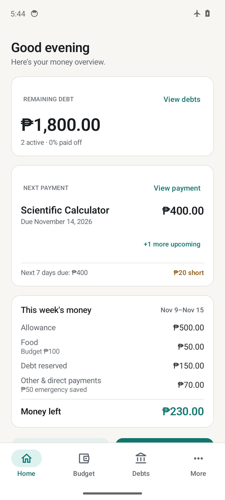
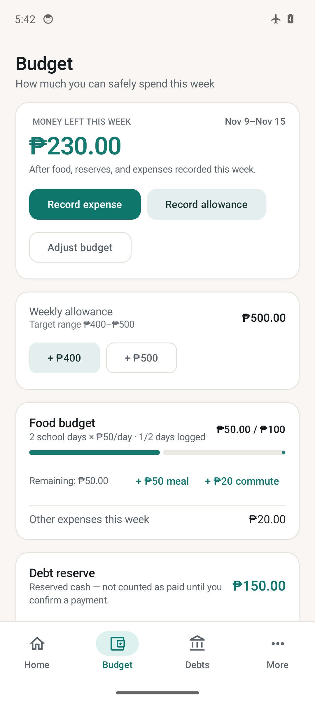
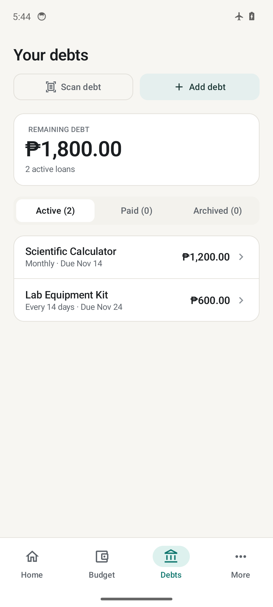
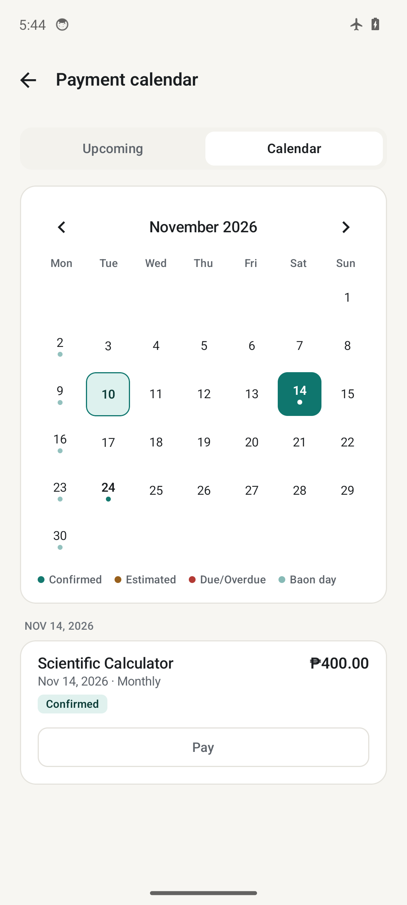

# BaonPlan

An offline Android app for managing allowance, expenses, debts, and savings. Built with Filipino students in mind.

## Screenshots

| Home | Budget | Debts | Payment Calendar |
| :---: | :---: | :---: | :---: |
|  |  |  |  |

## Features

- **Budget tracking** — Monitor allowance and everyday expenses.
- **Debt management** — Track loans, installments, and payment schedules.
- **Payment calendar** — Keep track of upcoming and overdue payments.
- **Financial overview** — Review spending, balances, and repayment progress.
- **Savings** — Set savings goals and manage emergency funds.
- **Offline storage** — Keep financial records on your device.
- **Debt scanning** — Extract loan details and repayment schedules from screenshots offline on your device for review before saving.

## Download

[Download the latest version](https://github.com/SODAAAH/BaonPlan/releases/latest)

Download the release APK and install it on your Android device.

**Requirements**: Android 8.0 (API 26) or later.

## Privacy

BaonPlan is designed to work entirely offline.

- No internet access or cloud synchronization.
- No third-party analytics or advertising trackers.
- Financial records are stored locally on the device (`android:allowBackup="false"`).
- Screenshot debt scanning runs locally on-device with no external uploads.
- Backups are created manually by the user.

See [SECURITY.md](SECURITY.md) for more information.

## Build from Source

### Requirements

- Android Studio
- JDK 17
- Android SDK 36

### Clone the repository

```bash
git clone https://github.com/SODAAAH/BaonPlan.git
cd BaonPlan
```

### Build the debug APK

On macOS/Linux:

```bash
./gradlew assembleDebug
```

On Windows:

```powershell
.\gradlew.bat assembleDebug
```

### Run tests and Android Lint

```bash
./gradlew testDebugUnitTest lintDebug
```

The debug APK will be generated at:

```text
app/build/outputs/apk/debug/app-debug.apk
```

## Contributing

Contributions, bug reports, and suggestions are welcome.

Please read [CONTRIBUTING.md](CONTRIBUTING.md) and our [Code of Conduct](CODE_OF_CONDUCT.md) before submitting a pull request.

## License

BaonPlan is licensed under the [MIT License](LICENSE).
